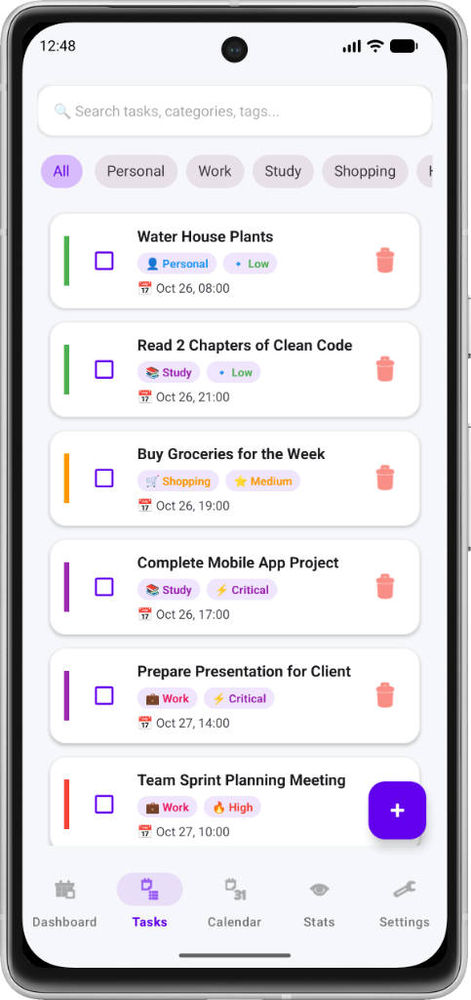
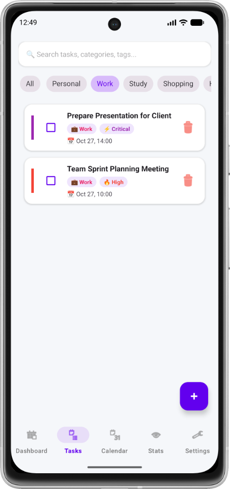
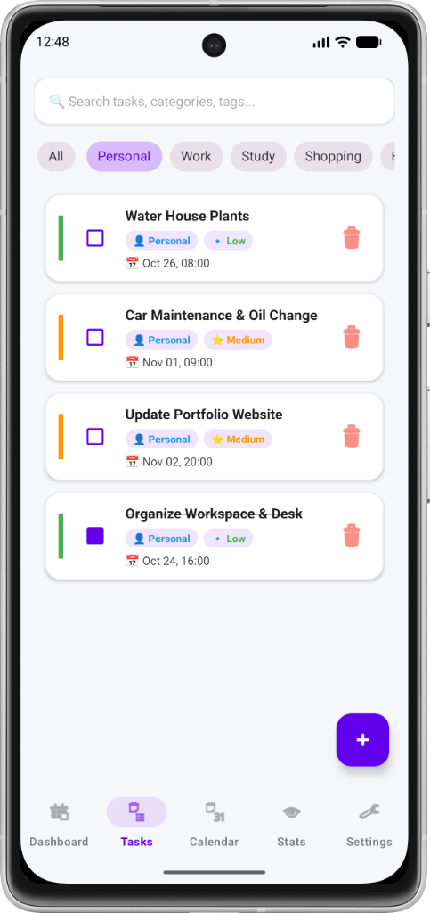
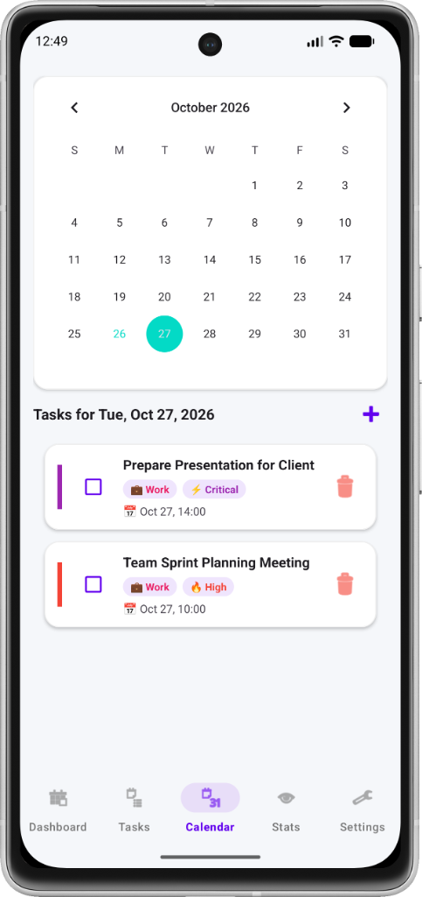
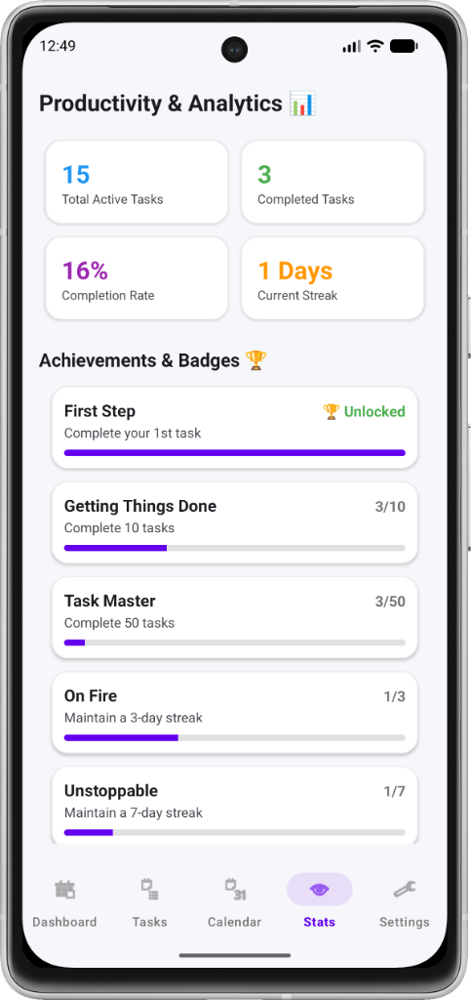
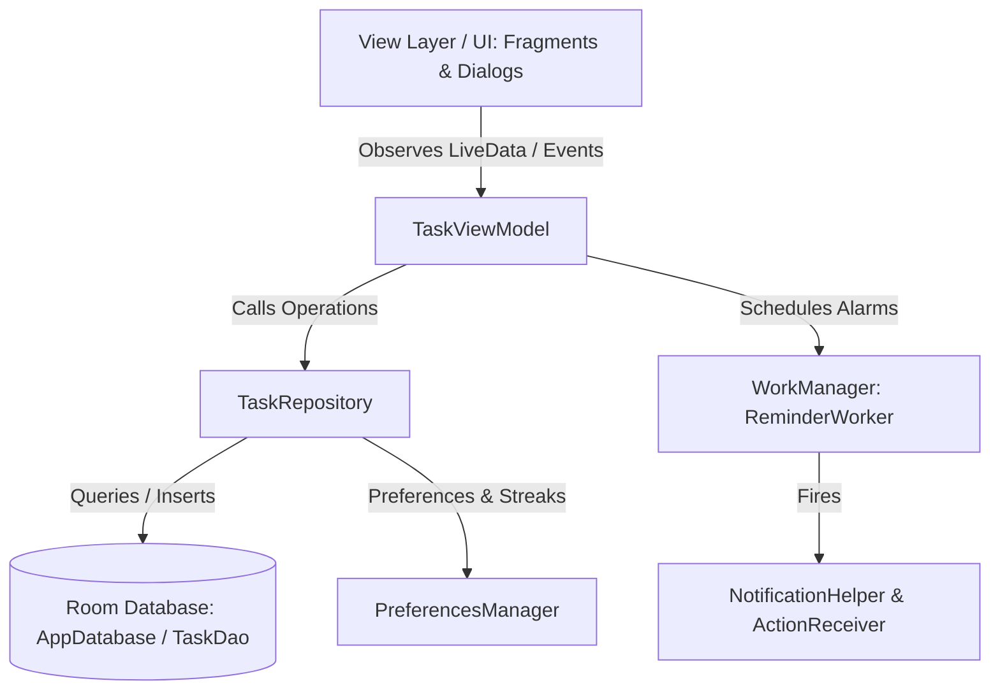

# 📱 FocusTask To-Do — Smart Task Management & Gamified Productivity

<p align="center">
  
  
  
  
  
  
</p>

---

## 📖 Overview

**FocusTask To-Do** is a modern, native Android productivity and task management application built in Kotlin. Engineered with **Material Design 3**, a robust **MVVM Clean Architecture**, and local-first offline persistence via **Jetpack Room**, FocusTask empowers users to effortlessly organize daily duties, track goals, and boost consistency through an engaging **gamification and streak engine**.

Whether planning sprints, tracking study goals, scheduling deadlines on an interactive calendar, or quickly capturing tasks using **natural language voice input**, FocusTask delivers a fluid, distraction-free experience with zero bloat and complete data privacy.

---

## 📸 Screenshots Showcase

<p align="center">
  
  &nbsp;&nbsp;
  
  &nbsp;&nbsp;
  
</p>

<p align="center">
  <em><b>Fig 1:</b> All Tasks & Priority System &nbsp;|&nbsp; <b>Fig 2:</b> Work Category Filtering &nbsp;|&nbsp; <b>Fig 3:</b> Personal Tasks & Completed State</em>
</p>

<br/>

<p align="center">
  
  &nbsp;&nbsp;
  
</p>

<p align="center">
  <em><b>Fig 4:</b> Interactive Calendar & Date-Based Schedule &nbsp;|&nbsp; <b>Fig 5:</b> Productivity Stats, Streaks & Achievement Badges</em>
</p>

---

## ✨ Key Features

### 📋 1. Smart Task & Subtask Organization
- **Priority Tiering**: Color-coded priority badges (**Low**, **Medium**, **High**, **Critical**) with visual indicator accents.
- **Category Segmentation**: Instant horizontal pill filters for `Personal`, `Work`, `Study`, `Shopping`, `Health`, `Finance`, and `Travel`.
- **Subtask Checklists**: Break complex objectives into bite-sized actionable steps with progress indicators.
- **Recurrence Engine**: Support for recurring task routines (`Daily`, `Weekly`, `Monthly`, `Yearly`).
- **Interactive Completion**: Quick one-tap checkbox toggle with animated strike-through and soft-trash removal.

### 🎙️ 2. Natural Language Voice & Smart Task Parsing
- Hands-free task capture through conversational text or voice transcription (`VoiceTaskParser`).
- Automatically extracts **Title**, **Due Date** (*"tomorrow"*, *"next week"*), **Time of Day** (*"morning"*, *"afternoon"*, *"evening"*), and **Priority** (*"urgent"*, *"critical"*, *"important"*).

### 📅 3. Interactive Calendar & Agenda View
- Visual month calendar showing active task distributions.
- Select any date to inspect scheduled deadlines and sprint items.
- Dedicated inline quick-add button to schedule events directly for the chosen day.

### 🏆 4. Gamification, Streaks & Badges Engine
- **XP Progression**: Earn +15 XP with every completed task to level up your productivity tier.
- **Streak Keeper**: Track consecutive days of task completion with visual streak counters (`🔥 X Days`).
- **Milestone Badges**: Unlockable achievements with real-time animated progress bars:
  - 🏅 **First Step** — Complete your 1st task
  - 🏅 **Getting Things Done** — Complete 10 tasks
  - 🏅 **Task Master** — Complete 50 tasks
  - 🔥 **On Fire** — Maintain a 3-day streak
  - ⚡ **Unstoppable** — Maintain a 7-day streak
- **Analytics Dashboard**: Real-time KPI cards displaying Total Active Tasks, Completed Tasks, Completion Rate %, and Streaks.

### ⏰ 5. Timely Reminders & Background Scheduling
- Built with **Android Jetpack WorkManager** for guaranteed, battery-efficient alarm delivery.
- Rich system notifications featuring direct **Quick Actions** (`Complete` or `Snooze 10m`) right from the notification drawer without launching the app.

### 🔒 6. Privacy & Security Lock
- Protect sensitive tasks, notes, and schedules with an optional **4-Digit PIN Lock** (`PinLockDialogFragment`).
- Prompts authentication upon launch when enabled in Settings.

### 🌗 7. Modern UI / UX & Dark Mode
- Full **Material Design 3** compliance with edge-to-edge system bar padding.
- Adaptive **Dark Mode** toggle with instant runtime theme switching.
- Clean typography, smooth cards, elevation shadows, and micro-interactions.

### 💾 8. Data Import / Export & Backup
- **JSON Export**: Export entire database backup to system clipboard with one tap.
- **JSON Import**: Easily restore or migrate tasks across devices without external dependencies.
- **Demo Mode**: Built-in seed generator to populate sample tasks for quick testing and onboarding.

---

## 🏗️ Architecture & Technology Stack

The project adheres to Google's official Android Architecture Guidelines implementing **MVVM (Model-View-ViewModel)** with single source of truth data flow:



### Core Libraries & Tools

| Component | Technology | Description |
| :--- | :--- | :--- |
| **Language** | [Kotlin](https://kotlinlang.org/) | 100% modern, idiomatic Kotlin |
| **UI Components** | [Material Components 3](https://github.com/material-components/material-components-android) | Modern Material Design UI widgets & theming |
| **Architecture** | [Android Jetpack](https://developer.android.com/jetpack) | ViewModel, LiveData, ViewBinding, Navigation |
| **Database** | [Jetpack Room](https://developer.android.com/training/data-storage/room) | SQLite abstraction layer with KSP compiler |
| **Background Work** | [Jetpack WorkManager](https://developer.android.com/topic/libraries/architecture/workmanager) | Reliable, battery-optimized background task execution |
| **Serialization** | [Google Gson](https://github.com/google/gson) | JSON serialization for subtasks and export/import |
| **Concurrency** | [Kotlin Coroutines](https://kotlinlang.org/docs/coroutines-overview.html) | Asynchronous non-blocking database queries |

---

## 📂 Project Directory Structure

```text
codvedx_t_1/
├── app/
│   ├── build.gradle.kts           # App-level dependencies & build configuration
│   └── src/main/
│       ├── AndroidManifest.xml    # App manifest & permissions
│       ├── java/com/example/codvedx_t_1/
│       │   ├── FocusTaskApp.kt    # Application class & dark mode initializer
│       │   ├── MainActivity.kt    # Root activity & bottom navigation controller
│       │   ├── data/
│       │   │   ├── local/         # Room Database & DAO interfaces
│       │   │   │   ├── AppDatabase.kt
│       │   │   │   └── TaskDao.kt
│       │   │   ├── model/         # Data entities (Task, Subtask, Achievement)
│       │   │   └── repository/    # TaskRepository abstraction
│       │   ├── receiver/          # Notification action broadcast receivers
│       │   ├── ui/
│       │   │   ├── TaskViewModel.kt
│       │   │   ├── adapter/       # RecyclerView adapters (Task, Subtask, Achievement)
│       │   │   ├── dialog/        # Add/Edit, TaskDetail, PinLock, VoiceTask dialogs
│       │   │   └── fragment/      # Dashboard, TaskList, Calendar, Statistics, Settings
│       │   └── util/              # Gamification, Notifications, Preferences, VoiceParser
│       └── res/                   # Layouts, drawables, navigation, colors & strings
├── screenshots/                   # Application preview screenshots
├── build.gradle.kts               # Top-level build configuration
├── settings.gradle.kts            # Project repositories & module settings
└── README.md                      # Project documentation
```

---

## 🗄️ Database Entity Schema

```kotlin
@Entity(tableName = "tasks")
data class Task(
    @PrimaryKey(autoGenerate = true) val id: Long = 0,
    var title: String,
    var description: String = "",
    var dueDate: Long = 0L,
    var dueTime: String = "",
    var priority: String = "MEDIUM",       // LOW, MEDIUM, HIGH, CRITICAL
    var category: String = "Personal",     // Personal, Work, Study, Shopping, Health, etc.
    var tags: String = "",
    var reminderTime: Long = 0L,
    var recurrence: String = "NONE",       // NONE, DAILY, WEEKLY, MONTHLY, YEARLY
    var subtasksJson: String = "[]",
    var notes: String = "",
    var createdAt: Long = System.currentTimeMillis(),
    var updatedAt: Long = System.currentTimeMillis(),
    var completedAt: Long = 0L,
    var isCompleted: Boolean = false,
    var isArchived: Boolean = false,
    var isDeleted: Boolean = false
)
```

---

## 🚀 Getting Started

### Prerequisites

Ensure you have the following installed on your workstation:
- **Android Studio** (Koala / Ladybug or newer recommended)
- **JDK**: Java 17 or higher
- **Android SDK**: API level 35 (compile SDK) with minimum API level 24

### Installation & Run

1. **Clone the Repository**:
   ```bash
   git clone https://github.com/akshar059/codvedx_t_1.git
   cd codvedx_t_1
   ```

2. **Open in Android Studio**:
   - Launch Android Studio.
   - Select **File > Open...** and navigate to the cloned project root.
   - Allow Gradle to sync dependencies.

3. **Build & Run via Gradle CLI** (Optional):
   ```bash
   # On Windows (PowerShell/CMD)
   .\gradlew.bat assembleDebug

   # On macOS / Linux
   ./gradlew assembleDebug
   ```

4. **Deploy**:
   - Connect an Android device with USB Debugging enabled (or start an Android Virtual Device / AVD).
   - Click the green **Run** button (or press `Shift + F10`) in Android Studio.

---

## 🧪 Testing

Execute unit and instrumentation tests via Gradle:

```bash
# Run local JVM unit tests
.\gradlew.bat test

# Run Android connected tests on emulator/device
.\gradlew.bat connectedAndroidTest
```

---

## 🤝 Contributing

Contributions, feature requests, and bug reports are welcome!

1. Fork the Project.
2. Create your Feature Branch (`git checkout -b feature/AmazingFeature`).
3. Commit your Changes (`git commit -m "Add AmazingFeature"`).
4. Push to the Branch (`git push origin feature/AmazingFeature`).
5. Open a Pull Request.

---

## 📄 License

Distributed under the **MIT License**. See `LICENSE` for more information.

---

<p align="center">
  Crafted with ❤️ for high productivity and focus.
</p>
